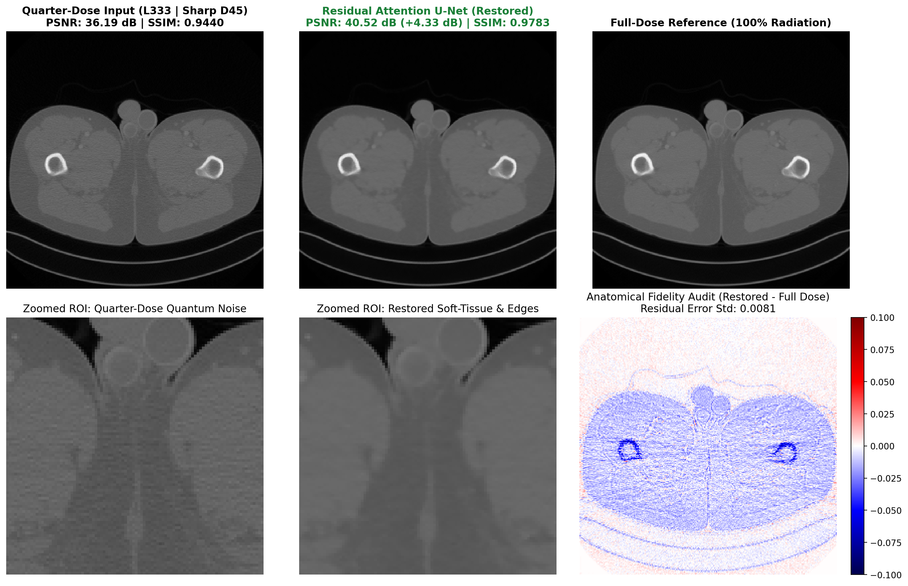

# Low-Dose CT Residual Attention U-Net Restoration

Paired **Low-Dose CT (LDCT)** to **Full-Dose CT (FDCT)** image restoration using a **Residual Attention U-Net** (`1,948,052` parameters). The model is trained on Google Colab (Tesla T4 GPU) on paired LDCT/FDCT scans spanning **Soft (B30)** and **Sharp (D45)** reconstruction kernels, and exported as a compressed CPU-ready `.joblib` bundle (`models/ldct_restorer_bundle.joblib`, ~7.0 MB) for fast local CPU inference via CLI (`predict.py`) and a browser-based Web UI (`app.py`).



---

## Quantitative Evaluation Results

Evaluated on **910 held-out paired CT test slices** (`data/ldct_test_metrics.csv`): **455 Soft Kernel (B30)** slices and **455 Sharp Kernel (D45)** slices.

### Overall Performance (All 910 Test Slices)

| Method | Mean PSNR (dB) | Mean SSIM | PSNR Gain vs. Raw LDCT | SSIM Gain vs. Raw LDCT |
| :--- | :---: | :---: | :---: | :---: |
| **Raw LDCT Input** | `41.1402` | `0.9580` | — | — |
| **Bilateral Filter (Classical Baseline)** | `37.9451` | `0.9590` | `-3.1951` | `+0.0010` |
| **Residual Attention U-Net (Ours)** | **`43.6622`** | **`0.9822`** | **`+2.5220`** | **`+0.0242`** |

### Breakdown by Reconstruction Kernel

| Kernel | Test Slices | Raw LDCT PSNR (dB) | Raw LDCT SSIM | Restored PSNR (dB) | Restored SSIM | PSNR Gain |
| :--- | :---: | :---: | :---: | :---: | :---: | :---: |
| **Soft Kernel (B30)** | 455 | `43.6857` | `0.9756` | **`45.2754`** | **`0.9880`** | `+1.5897 dB` |
| **Sharp Kernel (D45)** | 455 | `38.5947` | `0.9404` | **`42.0491`** | **`0.9763`** | `+3.4544 dB` |

---

## Model Architecture & Bundle Specification

Implemented in [`src/model.py`](src/model.py):

- **`ConvBlock`**: Two `3×3` convolutions (padding=1, `bias=False`), each followed by `BatchNorm2d` and `ReLU`.
- **`AttentionGate`**: Additive soft-attention gate (`wg`, `wx`, `ReLU → 1×1 Conv → Sigmoid`) applied to encoder skip connections before concatenation in the decoder.
- **`ResidualAttentionUNet`**:
  - 4-level encoder-decoder (`base_c = 32` → channels `32 → 64 → 128 → 256`, `1,948,052` total parameters).
  - Reflect-pads arbitrary input resolutions to multiples of `8` and crops back to the original spatial size.
  - Predicts the noise/artifact residual via `noise_head` and subtracts it globally: `clamp(x - noise_head(d1), 0.0, 1.0)`.

### Joblib Bundle (`models/ldct_restorer_bundle.joblib`)
- **Size**: `~7.0 MB` (compressed with `joblib.dump(..., compress=3)`)
- **Keys**:
  - `state_dict`: CPU `state_dict` tensors
  - `config`: `{'base_c': 32}`
  - `img_size`: `256`
  - `test_metrics`: `{'raw_psnr': 41.14, 'unet_psnr': 43.66, 'raw_ssim': 0.958, 'unet_ssim': 0.9822}`

---

## Repository Structure

```text
Medical_Image_Restoration/
├── app.py                               # Local CPU Web UI (http://127.0.0.1:7860)
├── predict.py                           # Local CPU CLI inference script
├── requirements.txt                     # Python dependencies
├── pytest.ini                           # Pytest configuration
├── assets/
│   └── ldct_clinical_diagnostics.png    # Evaluation & visual diagnostics figure
├── data/
│   └── ldct_test_metrics.csv            # 910-slice test metrics (B30 & D45 kernels)
├── models/
│   └── ldct_restorer_bundle.joblib      # Compressed CPU-ready model bundle (~7.0 MB)
├── notebooks/
│   └── ldct_residual_attention_unet.ipynb  # Google Colab T4 training & evaluation notebook
├── src/
│   ├── __init__.py
│   └── model.py                         # ConvBlock, AttentionGate, ResidualAttentionUNet
└── tests/
    └── test_restorer.py                 # Model, joblib bundle, CLI, and Web UI tests
```

---

## Setup & Installation

Python 3.10+ is recommended:

```bash
python3 -m venv .venv
source .venv/bin/activate
pip install -r requirements.txt
```

---

## Usage (Local CPU Inference)

### 1. Web Interface (`app.py`)
Launch the local browser interface:

```bash
.venv/bin/python app.py --bundle models/ldct_restorer_bundle.joblib --port 7860
```

Open **http://127.0.0.1:7860** in your browser:
- Upload or drag-and-drop a `.png`, `.jpg`, `.tif`, `.bmp`, `.dcm` (DICOM), or `.npy` CT slice.
- Adjust the **Restoration Strength** slider (`0.00–1.00`).
- Inspect the result with the **interactive before/after wipe slider** and download the restored PNG.

### 2. Command-Line Interface (`predict.py`)
Restore a single LDCT slice (`.png`, `.jpg`, `.tif`, `.dcm`, or `.npy`) and optionally save a side-by-side comparison:

```bash
.venv/bin/python predict.py \
  --input /path/to/low_dose_slice.png \
  --bundle models/ldct_restorer_bundle.joblib \
  --output restored.png \
  --compare comparison.png \
  --strength 1.0
```

---

## Running Tests

Run the unit and integration test suite (model forward/backward pass, `.joblib` bundle roundtrip, CPU `predict.py` inference, and `app.py` HTTP endpoints):

```bash
.venv/bin/python -m pytest -q
```

---

## Disclaimer

This repository is a research prototype trained on paired low-dose / full-dose CT data (`CT Low Dose Reconstruction`). It is intended for research and educational purposes only and is **not** a certified medical device or intended for clinical diagnosis.
